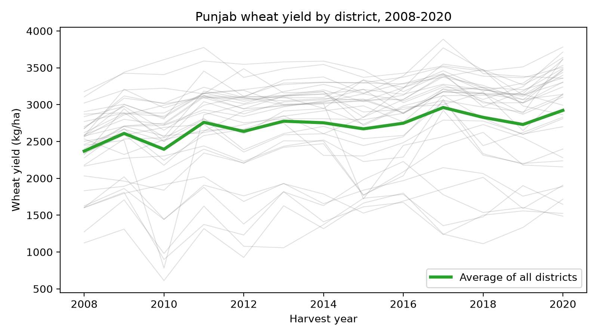
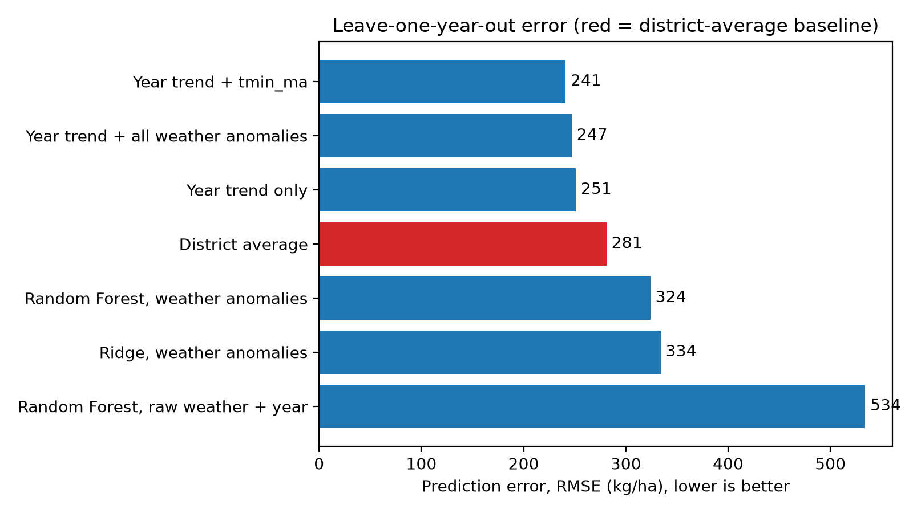
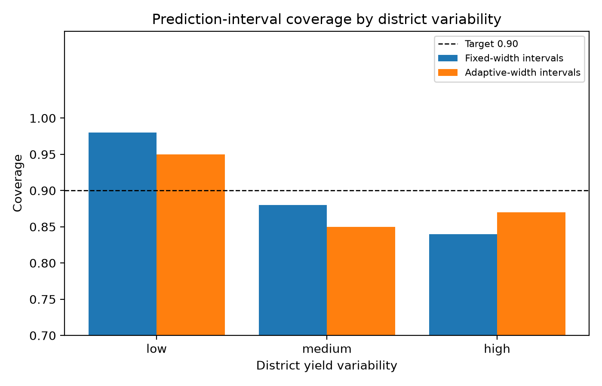

# Wheat Yield in Punjab: Does Weather Help, and How Reliable Are the Predictions?

**Author:**  Pakeeza Afzaal · District-level study, 36 districts of Punjab, Pakistan, harvest years 2008–2020

## What this project does

It predicts district wheat yield (kg/ha) from NASA weather data and year, and tests the models honestly: not just with a random split, but with whole years, districts and regions held out. It also checks whether conformal prediction intervals really cover 90% of true yields.

## Key findings

- **Random splits flatter the models.** Random Forest reaches R² ≈ 0.69, yet simply predicting each district's own average yield has a lower error (RMSE 287 vs 353 kg/ha).
- **For a new year, a trend beats weather.** District average + year trend: RMSE 251 (district average alone: 281). Adding a March–April minimum-temperature anomaly gave 241 and beat the trend-only model in 9 of 13 years, a modest hint and not a confirmed effect.
- **Conformal intervals hit about 90% coverage** for fully held-out years, and calibrating with a random split worked as well as calibrating with whole years held out.
- **Average coverage hides unevenness:** 0.98 for the least variable districts vs 0.84 for the most variable. Variability-scaled intervals narrowed the gap only partly (0.95 vs 0.87).

| Leave-one-year-out model | RMSE (kg/ha) |
|---|---|
| District average + year trend + tmin_ma | 241 |
| District average + year trend | 251 |
| District average | 281 |
| Random Forest, weather anomalies | 324 |
| Ridge, weather anomalies | 334 |

## Data

- **Yield:** Pakistan Bureau of Statistics tables (wheat area and production by district, 2007-08 to 2019-20), via opendata.com.pk. The portal lists no licence for these files, so they are not included here; the notebook downloads them.
- **Weather:** NASA POWER monthly data (rainfall, temperature, solar radiation) at approximate district-headquarters coordinates.
- **Cleaning:** division totals and Islamabad removed. Kasur 2010 had an implausible area value (64 vs about 130–194 in other years), giving a yield of 8,906 kg/ha; it was flagged and set to missing (likely a source typo, not verified). Chiniot has no data for 2008–2009. Final table: 465 rows with yield.

## Method in brief

Wheat season = November to April, split into three growth stages. Weather features are expressed relative to each district's average over the training years. Models: mean baseline, Ridge, Random Forest, gradient boosting, plus district-average and trend baselines. Validation: random 5-fold, and leave-one-district / year / region-out. Conformal intervals: 90% target, fixed-width vs adaptive.

## Limitations

- Only 13 seasons per district, so win counts and coverage are noisy.
- `tmin_ma` was chosen after seeing correlations on the full data, so its gain is optimistic.
- Weather is monthly and gridded (about 50 km; solar 1 degree), which hides short heat spells. No irrigation, fertiliser or variety data.
- Hyperparameters, the four regions and the interval-scaling setting were chosen by hand, not tuned.
- Results show associations, not causes. Figures 2 and 3 use numbers copied from notebook output.

## Files

`01_data_setup.ipynb` (full analysis) · `reports/` (results tables and figures)

## Credits

Yield data: Pakistan Bureau of Statistics, via Open Data Pakistan (opendata.com.pk), accessed October 2026. Weather data: NASA POWER Project, power.larc.nasa.gov, accessed October 2026.

Weather data were obtained from the NASA Langley Research Center POWER Project, which is funded through the NASA Earth Science Applied Science Program.SSS
